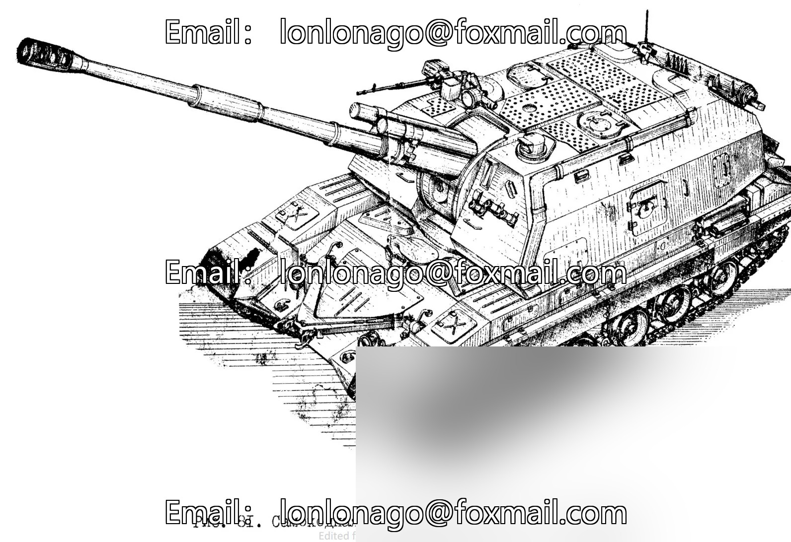
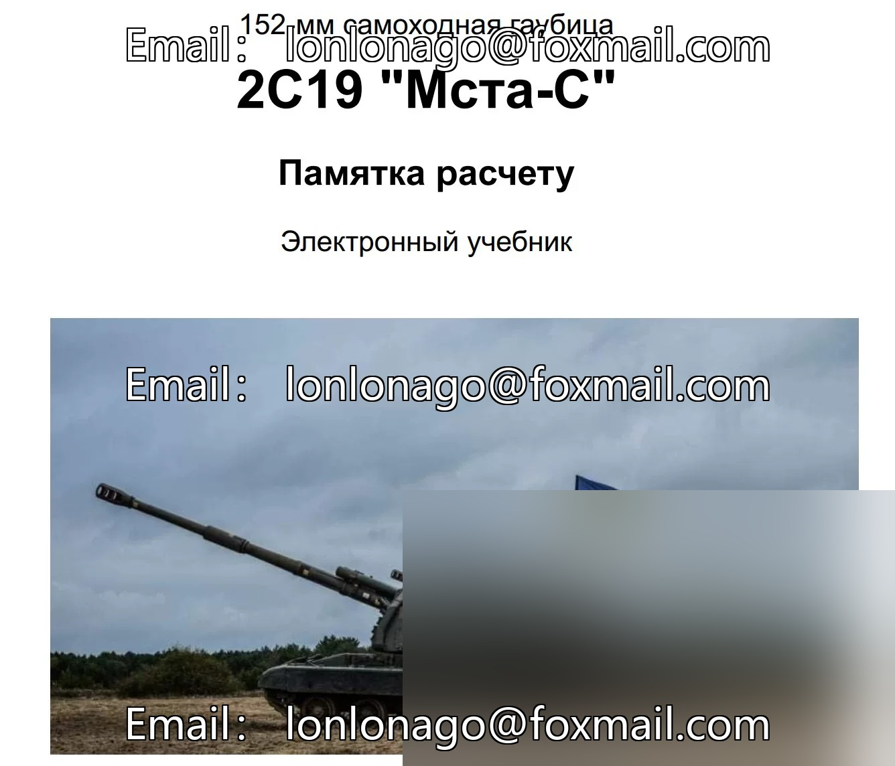
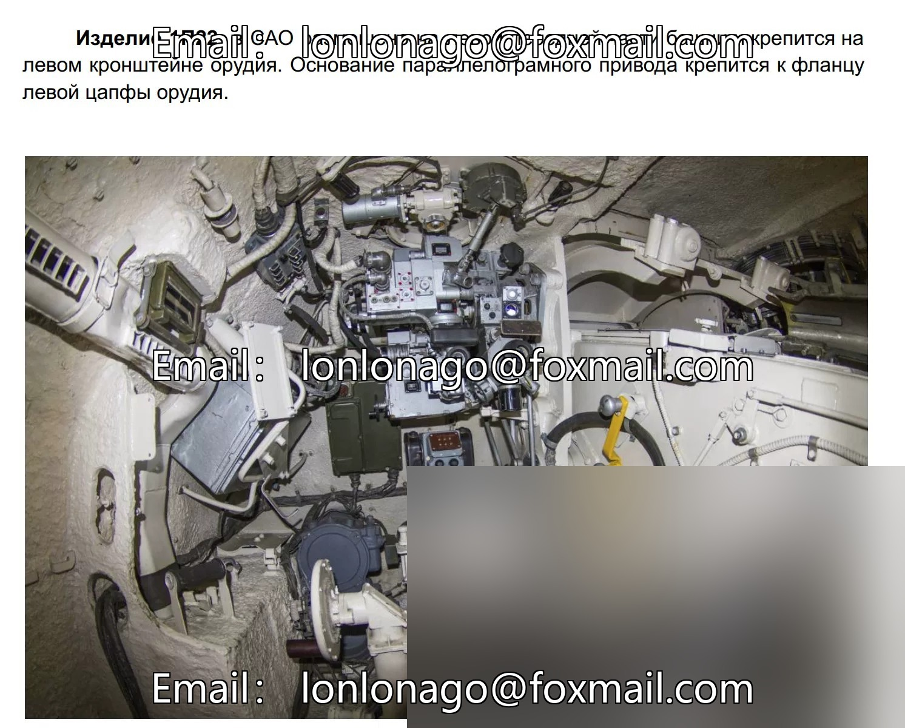
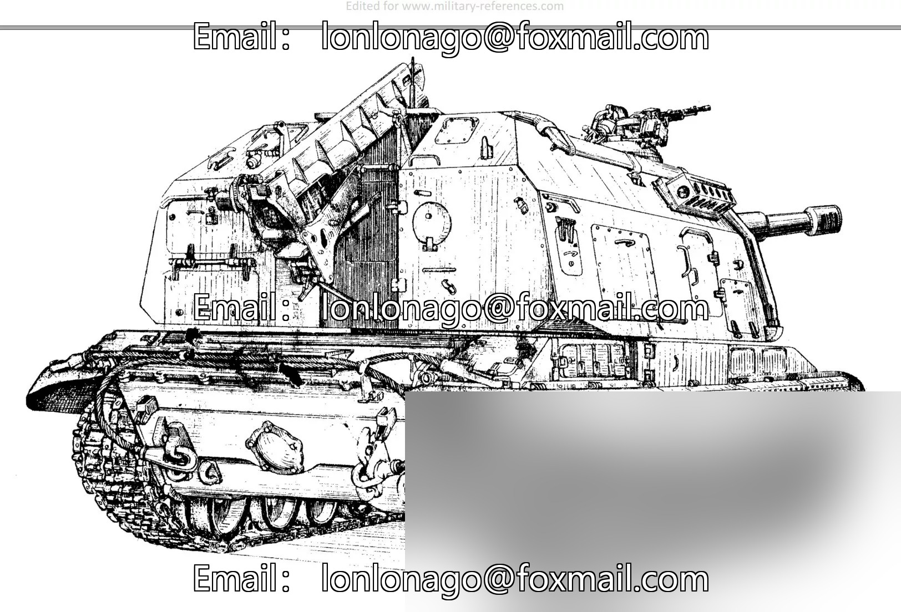

# 2S19 Msta-S technical document design materials

## Body

2S19 Msta-S Technical Document Design Materials - Russia
2S19 "Msta-S" (Msta-S) 152-mm self-propelled grenade launcher technical document information.
1. Document Classification and Core Content
(1)(1990)
Type: Technical manual and operation manual (targeted at gun crew members).
Key content:
Gun system structure (such as 2A64 grenade launcher, automatic loading machine, chassis design).
Operational process (shooting preparation, ammunition loading, emergency fault handling).
Background: The 1990 version corresponds to the early models equipped during the end of the Soviet era, emphasizing basic combat functions.
(2)
Type: Technical drawings and schematic diagram collection (excerpts).
Key content:

Mechanical structure decomposition diagram (such as turret rotation mechanism, suspension system).
Part number and assembly relationship, used for maintenance and assurance.
Use: Reference for engineering personnel for maintenance or for research by model enthusiasts.
(3) 2006)
Type: of turret group operation guide (modern upgraded version).
Key content:
Digital interface operation (e.g., use of fire control computer).
Tactical collaboration key points (linkage with drone, command system).
Background: The 2006 version reflects the informatization improvement of the Russian army, adapting to the needs of network-centered warfare.
have the replicability of copy, and are non-refundable after sale.

The materials cover Russian 2S19 Msta-S 152mm self-propelled mortar technical documents, including technical manuals, technical drawings and schematics, and operation guides.

<!-- AI_ENRICHED -->

## Images

## Payment

Here is a pay link on Stripe ( https://buy.stripe.com/3cs8yP7sY87d0vu9AB ). Please contact me lonlonago@foxmail.com after funding $89, and I will send you a complete data files , thank you!

